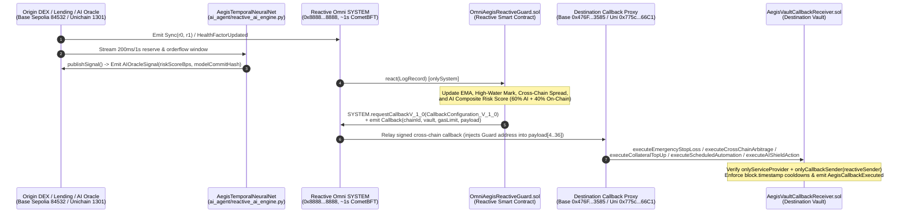

# Reactive Omni Aegis (`reactive-omni-aegis`)

> **Sub-Second Cross-Chain DeFi Protection, Zero-Keeper Personal Automations, and On-Chain Neural Threat Shield Built on Reactive Omni (`~1s` CometBFT Instant Finality)**

[](LICENSE)
[](contracts/)
[](https://dev.reactive.network/)

---

## 1. Overview & Why Reactive Omni Changes the Game

Prior to **Reactive Omni**, reactive smart contracts executed on `~7s` blocks. In modern L2 DeFi—where **Base Sepolia** produces blocks every **`200ms`** (post-Denim upgrade) and **Unichain Sepolia** produces blocks every **`1,000ms`**—a 7-second reaction window is an eternity: flash crashes liquidate borrowers, toxic orderflow drains AMM liquidity providers, and cross-chain arbitrage spreads vanish long before a callback lands.

**Reactive Omni** replaces legacy consensus with **CometBFT (`~1s` blocks and instant finality)**. **Reactive Omni Aegis** is a unified, production-grade reactive protocol and neural risk engine designed specifically to exploit this sub-second finality across all three tracks of the **Reactive Omni Buildathon**:

| Buildathon Track | Core Capability in `reactive-omni-aegis` | Origin Source | Reactive Omni Logic (`OmniAegisReactiveGuard.sol`) | Destination Callback (`AegisVaultCallbackReceiver.sol`) | Full-Loop Latency (Omni vs Legacy) |
| :--- | :--- | :--- | :--- | :--- | :--- |
| **Track 1: Every Second Counts** *(DeFi on Base Sepolia & Unichain Sepolia)* | **Sub-Second Flash-Crash Stop-Loss, Cross-DEX Arbitrage & Lending Liquidation Shield** | Base Sepolia (`84532`, `200ms`) & Unichain Sepolia (`1301`, `1s`) `Sync`, `Swap`, and `HealthFactorUpdated` logs | Computes real-time EMA price, high-water-mark drawdown (`>= 500 bps`), single-block volatility spikes (`>= 350 bps`), and Base↔Unichain price gaps (`>= 150 bps`) | `executeEmergencyStopLoss`, `executeCrossChainArbitrage`, `executeCollateralTopUp` | **`1.4s – 2.2s`** vs `7.4s – 8.2s` (**`5.29x` faster**) |
| **Track 2: Set It and Forget It** *(Personal Automations)* | **Zero-Keeper Recurring DCA & Range Rebalance with `200ms`-Safe Timestamp Cooldowns** | Reactive Network native `Cron100` (`0x0000...fffFfF`) + `ScheduleRegistered` logs | Tracks user automation schedules in reactive state and dispatches scheduled execution callbacks on every `Cron100` tick | `executeScheduledAutomation` enforcing strict `block.timestamp` intervals (immune to Base Sepolia's `200ms` block rate) | **`1.2s`** vs `7.2s` (**`6.00x` faster**) |
| **Track 3: Reactive Meets AI** *(Neural Networks + Reactive Contracts)* | **Temporal Residual MLP Threat Predictor in the Live Loop** | `AIThreatSignalEmitter.sol` (`AIOracleSignal`) driven by `AegisTemporalNeuralNet` | Fuses neural threat probability (`60%` weight) with on-chain realized volatility/drawdown (`40%` weight) inside `react()` | `executeAIShieldAction` preemptively shifting `40%` of volatile exposure to stable reserves and recording `modelCommitHash` | **`1.4s`** vs `7.4s` (**`5.29x` faster**) |

---

## 2. System Architecture & End-to-End Event Loop



---

## 3. Official Reactive Omni Protocol Compliance

`reactive-omni-aegis` is built directly against the official **`reactive-lib-omni`** specification:

1. **Canonical Reactive Omni System Contract (`0x8888888888888888888888888888888888888888`)**:
   - [`OmniAegisReactiveGuard.sol`](contracts/OmniAegisReactiveGuard.sol) inherits [`AbstractReactive`](lib/reactive-lib-omni/src/base/AbstractReactive.sol), binding `_SERVICE_PROVIDER` and `SYSTEM` to `0x8888888888888888888888888888888888888888` and guarding `react(LogRecord calldata log_)` with `onlySystem`.
   - Requests cross-chain callbacks via `SYSTEM.requestCallbackV_1_0(ISystemContract.CallbackConfiguration_V_1_0({ chainId, recipient, gasLimit, payload }))` while also emitting `IReactive.Callback` for universal indexer compatibility.
2. **160-Bit Reactive Sender Injection & Dual Callback Authentication**:
   - Every callback payload reserves its first parameter as `address(0)` (`executeEmergencyStopLoss(address(0), ...)`), which the destination Callback Proxy (`0x476F44b11F5C942c58f4c8E3d0300E5710743585` on Base Sepolia, `0x775c9B990ADe401060B78D0e98684eEf8d2466C1` on Unichain Sepolia) overwrites with `address(omniAegisReactiveGuard)`.
   - [`AegisVaultCallbackReceiver.sol`](contracts/AegisVaultCallbackReceiver.sol) inherits [`AbstractCallback`](lib/reactive-lib-omni/src/base/AbstractCallback.sol) and guards every callback entrypoint with both `onlyServiceProvider` and `onlyCallbackSender(reactiveSender)`.
3. **Base Sepolia `200ms` Block Time Safety (Denim Upgrade Ground Rule)**:
   - All cooldowns, recurring DCA intervals, and circuit-breaker windows in `AegisVaultCallbackReceiver.sol` use `block.timestamp` rather than `block.number`.
4. **Native Reactive `Cron100` Subscription & Runtime Subscription Management**:
   - Subscribes to `CRON100_TOPIC_0` (`0xb49937fb8970e19fd46d48f7e3fb00d659deac0347f79cd7cb542f0fc1503c70`) on `LEGACY_SYSTEM_ADDR` (`0x0000000000000000000000000000000000fffFfF`) and supports `pauseSubscriptions()`, `resumeSubscriptions()`, and `coverDebt()`.

---

## 4. Repository Structure

```text
reactive-omni-aegis/
├── contracts/
│   ├── OmniAegisReactiveGuard.sol      # Core Multi-Track Reactive Contract (Reactive Omni 5318007 / 1597)
│   ├── AegisVaultCallbackReceiver.sol  # Authenticated Destination Vault (Base Sepolia 84532 / Unichain 1301)
│   ├── AIThreatSignalEmitter.sol       # On-Chain AI Risk Oracle Bridge ("Reactive Meets AI")
│   └── mocks/
│       ├── MockOmniSystemContract.sol  # Full simulation of Reactive Omni SYSTEM (0x8888...8888)
│       ├── MockCallbackProxy.sol       # Destination Callback Proxy simulator (160-bit sender injection)
│       ├── MockDEXPool.sol             # AMM Pool emitting Sync & Swap logs
│       └── MockLendingMarket.sol       # Lending protocol emitting HealthFactorUpdated logs
├── lib/
│   └── reactive-lib-omni/              # Official Reactive Omni interfaces & abstract base contracts
├── test/
│   ├── OmniAegis.t.sol                 # Solidity Full-Loop Integration & Security Test Suite
│   └── omni-aegis.test.js              # In-Memory EVM Bytecode Execution Test Suite (@ethereumjs/vm + ethers)
├── ai_agent/
│   ├── reactive_ai_engine.py           # 2-Layer Temporal Residual MLP Risk Engine & Latency Simulator
│   └── test_ai_engine.py               # Python Unit & Solidity Compiler Verification Tests
├── script/
│   └── DeployOmniAegis.s.sol           # Foundry Multi-Chain Deployment Script
└── scripts/
    └── deploy-and-verify.sh            # One-Command Deployment & Sourcify Verification Script
```

---

## 5. Quickstart: Build, Test & Run Cross-Chain Simulation

### Run the Full EVM Bytecode & Neural Network Test Suite
```bash
npm test
```

### Run the Neural Network Risk Engine & Cross-Chain Latency Benchmark
```bash
npm run simulate
```

### Deploy & Verify on Reactive Lasna (`5318007`), Base Sepolia (`84532`) & Unichain Sepolia (`1301`)
```bash
PRIVATE_KEY=0x... REACTIVE_PRIVATE_KEY=0x... ./scripts/deploy-and-verify.sh
```

---

## 6. Measured Latency Benchmarks (Reactive Omni vs Legacy Reactive)

| Loop Stage | Base Sepolia (`84532`) + Reactive Omni | Unichain Sepolia (`1301`) + Reactive Omni | Legacy Reactive Network (`~7s` blocks) |
| :--- | :---: | :---: | :---: |
| **1. Origin Event Inclusion** | `200 ms` (Denim 200ms block) | `1,000 ms` (1s block) | `200 ms – 1,000 ms` |
| **2. Reactive `react()` Finality** | **`~1,000 ms` (CometBFT instant finality)** | **`~1,000 ms` (CometBFT instant finality)** | `~7,000 ms` |
| **3. Destination Callback Execution** | `200 ms` | `200 ms` (Base) / `1,000 ms` (Unichain) | `200 ms – 1,000 ms` |
| **Total End-to-End Loop Time** | **`1,400 ms` (`1.4s`)** | **`2,200 ms` (`2.2s`)** | **`7,400 ms – 9,000 ms`** |
| **Net Speedup** | **`5.29x Faster`** | **`3.73x Faster`** | `1.00x (Baseline)` |
